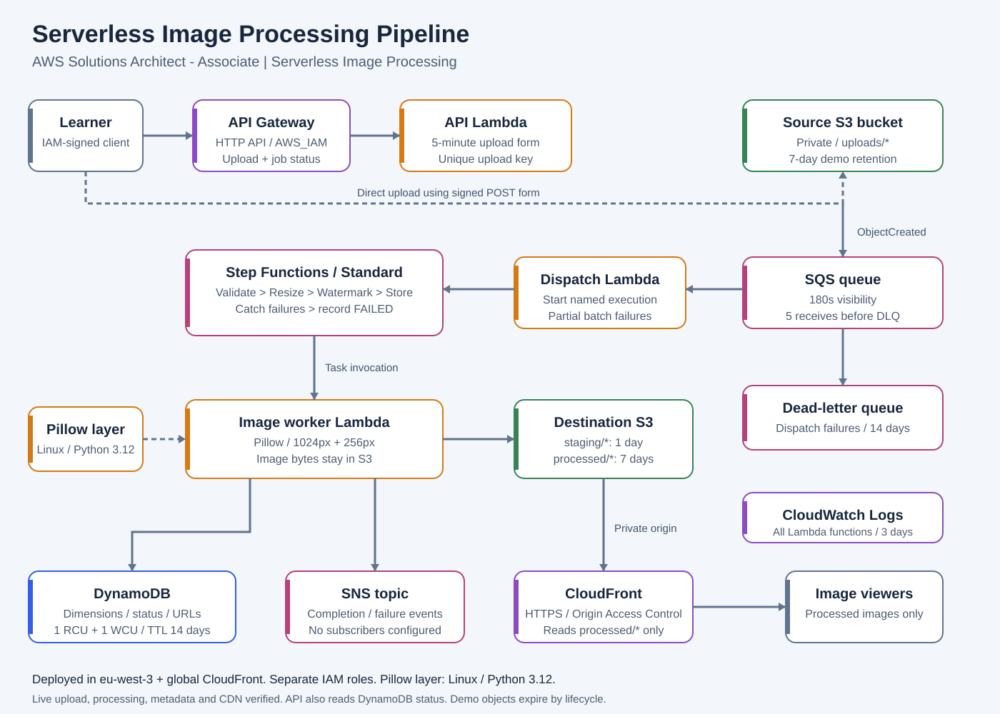

# Serverless Image Processing Pipeline

I built this serverless image processing pipeline as part of my preparation for
the AWS Certified Solutions Architect - Associate certification. I used Python
for image processing and Terraform to define the AWS infrastructure. My goal was
to practice event-driven architecture, service integration, and least-privilege IAM.

**Status: built, deployed, tested, and cleaned up on October 17, 2026.**
I verified the complete pipeline on AWS, including authenticated API uploads,
image processing, metadata lookup, and CloudFront delivery. After testing, I
removed all 43 Terraform-managed resources and checked that the Terraform state
was empty. The live demo URLs are now offline; the code, diagram, test report,
and sample images remain in this repository.

## Solution architecture

[Open the editable SVG](docs/architecture.svg). A PNG can be generated locally with
`python scripts/draw_architecture.py`.

1. An IAM-authenticated client calls API Gateway's HTTP API to request an upload.
2. The API Lambda returns a five-minute S3 POST form with an exact, unique object
   key, an image Content-Type constraint, and a 20 MiB size limit. The client
   uploads directly to the private source bucket, under uploads/.
3. S3 ObjectCreated events enter a standard SQS queue. A dispatch Lambda starts
   a named Standard Step Functions execution. Duplicate notifications reuse the
   same execution name; only dispatch failures are retried through SQS and its DLQ.
4. Step Functions invokes an image-worker Lambda for validate → resize → watermark
   → store. The worker loads Pillow from a separate Linux Python 3.12 Lambda Layer.
5. The workflow creates a main JPEG fitting 1024 × 1024 and a thumbnail fitting
   256 × 256, both marked Cloud & AI. Intermediate files remain in S3, so image
   bytes do not enter Step Functions state.
6. DynamoDB stores the source key, upload event time, dimensions, status, output
   keys, and delivery URLs. An IAM-authenticated status route reads this record.
7. The worker publishes a COMPLETED or FAILED event to SNS. The topic has no
   subscribers by default; no email or SMS is sent by this configuration.
8. CloudFront serves processed images over HTTPS using Origin Access Control.
   The output bucket stays private; the CloudFront policy permits processed/* only.

Processing and CloudFront delivery default to disabled in reusable Terraform.
I enabled both for the live test, then disabled them before removing the demo
infrastructure. API Gateway requires IAM authentication. See my
[live demonstration evidence](docs/live-demo.md).

## What I implemented

| Component | Implementation |
|---|---|
| Source and destination S3 | Private buckets, ownership controls, AES256 encryption, source notifications |
| SQS and DLQ | Standard queue, 180-second visibility, maxReceiveCount 5, 14-day DLQ retention |
| Resize and watermark Lambda | workflow.py and processor.py; main image plus thumbnail |
| Pillow Lambda Layer | build/pillow-layer.zip with python/ at the root; worker layer attachment |
| Standard Step Functions workflow | infra/workflow.asl.json.tftpl; per-task retry and failure paths |
| API Gateway upload endpoint | POST /uploads, AWS_IAM, bounded presigned S3 POST |
| DynamoDB metadata | Provisioned 1 RCU/1 WCU, job status and dimensions, TTL |
| CloudFront | HTTPS, signed origin access, processed-images-only bucket policy |
| SNS | Completion/failure publishing; recipients deliberately not configured |
| S3 lifecycle | Staging expires after 1 day; demo source/results after 7 days |
| Architecture diagram | SVG embedded above; PNG generated by the renderer |
| Documentation | This README, infrastructure notes, Free plan review, validation record |
| Live demonstration | PASS through authenticated API upload, metadata lookup, and CloudFront |

## Demonstration result

I uploaded a sample image through the authenticated API and verified that the
job completed with a 1024 × 683 main JPEG and a 256 × 171 thumbnail. I saved
these results before deleting the AWS resources:

[Main JPEG](docs/evidence/image.jpg) · [Safe live-test report](docs/evidence/live-api-result.json)
· [Evidence record](docs/live-demo.md) · [Cleanup instructions](docs/cleanup.md)

## Repository layout

    .
    ├── README.md
    ├── processor.py                 # Shared image operations
    ├── pipeline_common.py           # Lazy SDK access, limits, job identity
    ├── workflow_starter.py          # SQS -> Standard workflow dispatch
    ├── workflow.py                  # Validate/resize/watermark/store/fail tasks
    ├── upload_api.py                # Signed-upload and metadata HTTP routes
    ├── lambda_function.py           # Original direct pipeline, retained for learning/tests
    ├── test_lambda_function.py      # 16 original mocked integration tests
    ├── test_workflow.py             # 20 workflow/API tests
    ├── requirements-lambda.txt      # Pillow version pin
    ├── scripts/                     # Build, Docker test, architecture renderer
    ├── infra/                       # Terraform, workflow definition, mocked tests
    └── docs/                        # Diagram, validation, Free plan review

Generated ZIPs, the virtual environment, Terraform provider downloads, state,
local variable values, and credential files are excluded from version control.
The Terraform provider lock file is included for reproducible provider selection.

## Run locally

Prerequisites: Python with Pillow 12.3.0, Terraform >= 1.7 and < 2, and Docker
Desktop running Linux containers for the Lambda compatibility check. The build
and Terraform configuration target Python 3.12 / x86_64.

From the project root in PowerShell, using the existing environment:

    .\.venv\Scripts\python.exe -m unittest -v test_lambda_function test_workflow

The S3 client uses the configured AWS Region, an explicit regional endpoint,
Signature Version 4, and virtual-hosted bucket addressing. This prevents uploads
from relying on redirects from the global S3 endpoint.

The tests use actual Pillow transformations with fake S3, Step Functions,
DynamoDB, and SNS clients. Socket connections are blocked during every test.
No AWS account, password, or access key is needed. Deliberate corrupt-image and
service-failure tests emit expected warning lines. Expected result: 36 tests, OK.

For a fresh checkout, create a virtual environment and install the pinned Pillow
requirement first. Dependencies come from public PyPI; no cloud resources are
needed for these tests.

### Build the application and layer

    .\.venv\Scripts\python.exe scripts/build_lambda.py --download

This downloads a pinned Linux CPython 3.12 Pillow wheel from public PyPI. If the
wheel is already in build/wheels/, omit --download to build offline. The builder
produces application.zip, pillow-layer.zip, a legacy standalone lambda.zip,
and manifest.json with SHA256 hashes under build/.

Terraform uses **application.zip + pillow-layer.zip**, not the Windows virtual
environment. AWS Lambda supplies boto3 in the runtime. Only the image worker
needs the Pillow layer; the dispatcher and API do not load image libraries.

### Check the package in the Lambda runtime

    .\.venv\Scripts\python.exe scripts/smoke_test_lambda.py

Docker may download the public Lambda Python 3.12 image on its first run. The
container has no network access and receives only selected read-only files.
It extracts the application and layer separately, verifies import locations,
and runs all 36 application tests. A PASS updates layered_runtime_smoke_test in the manifest
for the exact application and layer hashes. This does not deploy resources.

### Check Terraform without AWS calls

    terraform -chdir=infra fmt -recursive
    terraform -chdir=infra init -backend=false
    terraform -chdir=infra validate
    terraform -chdir=infra test

init downloads the provider from the public Terraform Registry. The tests use
mock_provider for all AWS resources and data sources and execute a mocked plan.
Their plain-text hash fixture is never uploaded. These commands do not create
AWS resources. Ordinary terraform plan can contact AWS; terraform apply creates
resources. The deployment used reviewed saved plans; do not apply the old
preflight plans or change the account plan.

## Interface and storage contracts

| Route | Authentication | Behavior |
|---|---|---|
| POST /uploads | AWS_IAM / SigV4 | JSON body with filename; returns job_id, source_key, upload.url and upload.fields |
| GET /jobs/{job_id} | AWS_IAM / SigV4 | Returns typed metadata; 404 until the job exists; 400 for invalid IDs |

The upload request accepts filenames ending in JPG, JPEG, PNG, WEBP, BMP, TIF,
TIFF, or GIF. It derives the Content-Type from the extension and uses a new UUID
for the object key. Animated images produce one still frame. MIME policies are
an upload constraint; the validation task also inspects the actual image.
Decoded images are capped at 20 million pixels. EXIF orientation is applied.

The job ID is SHA256(source-bucket + / + source-key). Output keys are:

    staging/<job_id>/image.png
    staging/<job_id>/thumbnail.png
    staging/<job_id>/image.jpg
    staging/<job_id>/thumbnail.jpg
    processed/<job_id>/image.jpg
    processed/<job_id>/thumbnail.jpg

Metadata status is PROCESSING after validation, COMPLETED after output storage,
or FAILED when the workflow's failure-recording task succeeds. Dimensions in
metadata describe the orientation-corrected source. The metadata record expires
via DynamoDB TTL after 14 days; TTL deletion is asynchronous.

This is a single-owner learning API. IAM authentication does not implement
multi-tenant record ownership; callers authorized for the status route can query
known job IDs. Processed images are intended for public CDN viewing, so use
non-sensitive demonstration images. Source/staging objects are never exposed by
the CloudFront bucket policy.

## Reliability and limitations

- SQS absorbs bursts and retries failures to start workflows. Once Step Functions
  accepts a job, SQS acknowledges it; downstream image failures belong to workflow
  failure handling, not the SQS DLQ.
- Each stage writes deterministic intermediate/output keys, making retries safe
  for object storage. Standard execution names suppress duplicate starts for
  90 days. Use a new upload key for a new job or deliberate retry of a failed job.
- Overwriting an existing upload key is unsupported. The API always generates
  new keys; direct manual uploads must do the same. This avoids ambiguous ordering.
- SNS delivery is at least once. Retrying a store/failure task can publish duplicate
  events. With no subscribers configured, there is no external delivery yet.
- Catch paths record ordinary task failures. A workflow-wide timeout or a failure
  of the recording task itself can leave metadata incomplete; inspect execution
  history and CloudWatch Logs. There is no claim of exactly-once processing.
- The main output is a resized JPEG, not a preserved full-resolution original.
  The source remains available in its private bucket until lifecycle expiry.
- Lifecycles intentionally delete demo uploads/results after 7 days and staging
  after 1 day. CloudFront can cache an object for up to another day. force_destroy
  is false, so Terraform does not automatically empty buckets during destruction.

## Cost management

I used small provisioned capacity, short log retention, and S3 lifecycle rules
to limit usage during testing. I kept the account on the AWS Free plan and did
not enable paid-only features or upgrade the account. Free plan credits can be
consumed by eligible usage; resource limits are not a billing cap.

After saving the demonstration evidence, I emptied the demo buckets and used
Terraform to remove all 43 project resources. I verified that `terraform state
list` returned no resources. This cleanup covers this project, not other
resources that may exist in the AWS account.

The [service eligibility review](docs/free-plan-review.md) documents my service
choices, and the [cleanup runbook](docs/cleanup.md) describes the removal steps.

## Verification results

I checked the implementation locally and in AWS:

- Terraform validation and the mocked infrastructure test passed.
- All 36 application tests passed in the Lambda Linux Python 3.12.15 runtime.
- Eight additional API-client tests passed locally, for 44 offline tests in total.
- The live authenticated upload, presigned S3 POST, status lookup, and CloudFront
  image downloads passed. I also verified that unsigned API requests were rejected.
- Cleanup removed all 43 project resources, and the Terraform state was empty.

[Validation details](docs/validation.md) · [Live demonstration evidence](docs/live-demo.md)
· [Infrastructure details](infra/README.md)

I kept the JPEG samples and test report in the repository so the results can
still be reviewed after cleanup. The original AWS API and CloudFront URLs are
no longer available.

## Run the live API demonstration

The commands below are for a new deployment; my demo infrastructure has been
removed. After deploying your own copy and enabling processing and delivery,
run these commands from the project root in PowerShell:

    .\.venv\Scripts\python.exe -m pip install "boto3[crt]"
    .\.venv\Scripts\python.exe demo.py
    $projectApiUrl = terraform '-chdir=infra' output -raw api_url
    .\.venv\Scripts\python.exe scripts/live_api_demo.py --api-url $projectApiUrl

The client uses an existing AWS profile with execute-api:Invoke permission.
Use --profile to select a named profile. It uploads one image, polls its job
status, verifies both CloudFront JPEGs, and saves a result report under build/.
Credentials and signed upload form fields are not printed or saved in that report.

To run the client's offline tests:

    .\.venv\Scripts\python.exe -m unittest -v test_live_api_demo

[Source repository](https://github.com/ESSAFI01/AWS-Serverless-Image-Processing-Pipeline-)
